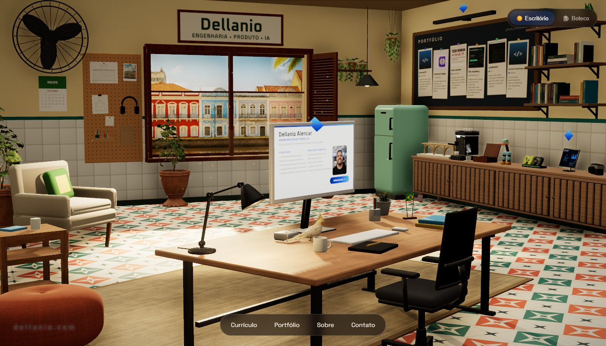
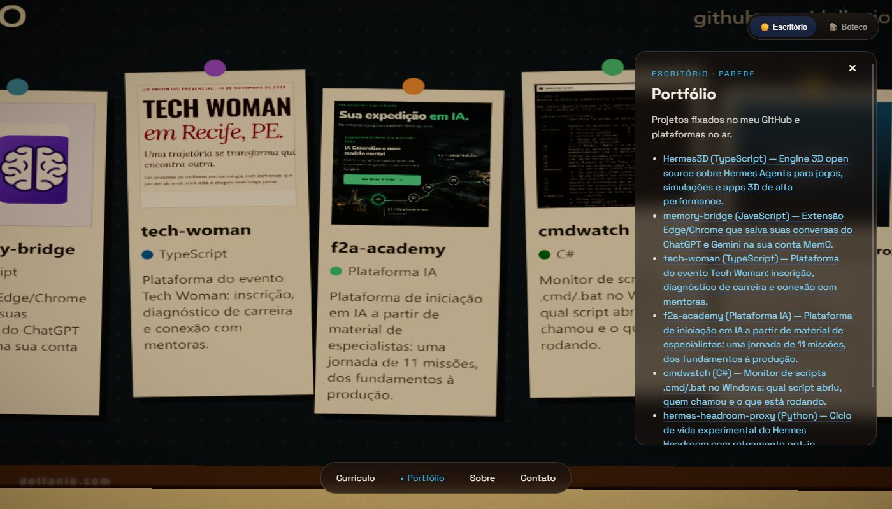
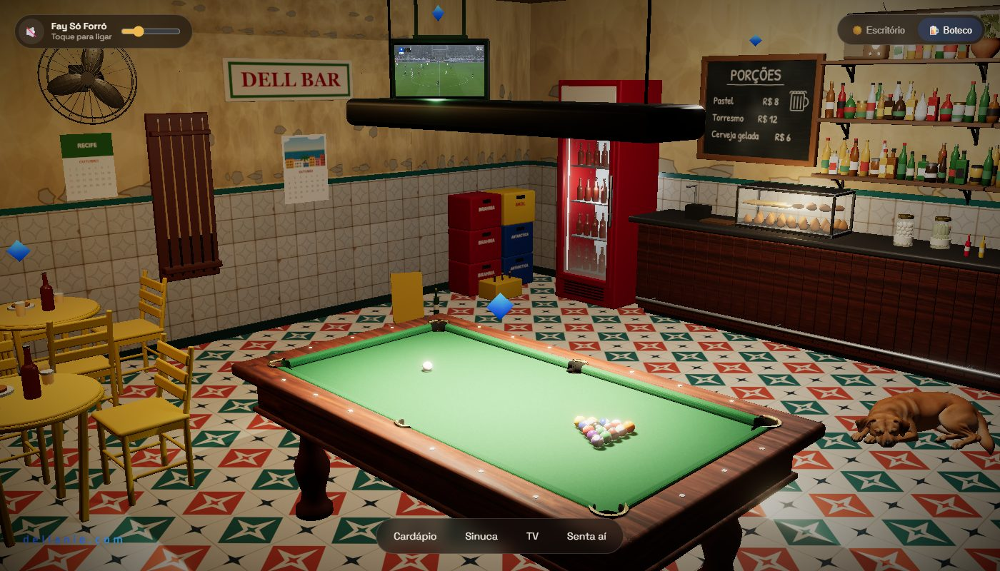
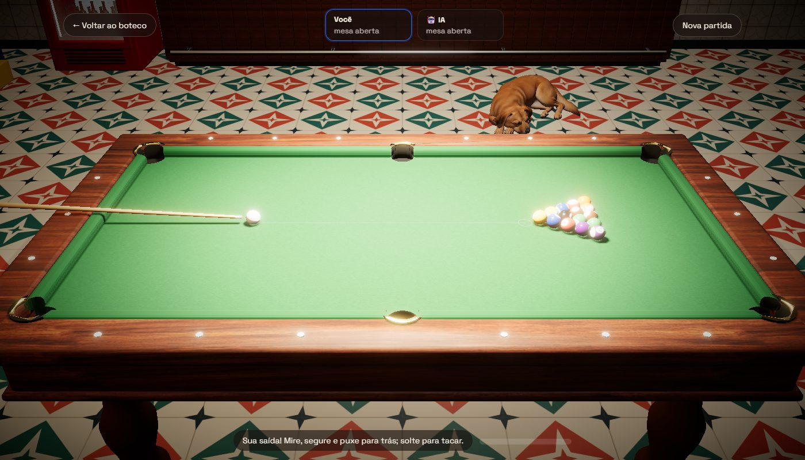

<div align="center">

# dellanio.com

**Um escritório em Recife que vira boteco depois das 18h.**

O site pessoal de [Dellanio Alencar](https://www.linkedin.com/in/dellanio/): Engineering Manager,
engenharia de software, arquitetura e IA aplicada, num cenário 3D que dá para explorar.

[**dellanio.com**](https://dellanio.com) · [Boteco](https://dellanio.com/?mode=night) · [English](https://dellanio.com/?lang=en)




</div>

---

## O que é

Em vez de um currículo em página comum, o site é uma sala 3D. Cada objeto é uma seção:

- o **computador** abre o currículo;
- o **quadro de cortiça** na parede mostra o portfólio;
- a **estante** conta quem eu sou e lista meus últimos artigos do Medium;
- o **tablet** no aparador leva aos contatos.

Depois das **18h** (horário do visitante) a mesma sala vira um **boteco**, com sinuca jogável,
rádio de forró e uma TV passando futebol. Quem preferir pode alternar a qualquer hora pelo botão
**Escritório / Boteco** no canto da tela.

## Modo escritório

Um escritório de dia, com luz entrando pela janela, vista dos sobrados do Recife e nuvens que
se movem atrás deles. Tem uma calopsita sobre a mesa, um Mac mini ao lado do monitor, café, uma
estante com livros e um quadro com os projetos fixados.

| | |
|---|---|
|  | Clique no quadro para ver os projetos: Hermes3D, memory-bridge, tech-woman, f2a-academy, cmdwatch e outros. Cada cartão leva ao repositório ou à plataforma no ar. |

As **bandeirinhas** sobre a mesa trocam o idioma do site entre **português** (padrão) e **inglês**.

## Modo boteco



O mesmo cômodo, à noite: azulejos antigos, mesas amarelas com cerveja, freezer gelando, cachorro
dormindo no chão e o cardápio de serviços no quadro de giz.

- **TV**: já fica ligada, sem som, passando vídeos de futebol sorteados. Clique nela para dar
  foco: entra o som da TV e o rádio faz uma pausa.
- **Rádio**: sintoniza uma emissora de forró ao entrar no boteco, com volume baixo, controle de
  volume e notinhas musicais subindo. Em celulares, o navegador exige um toque antes de liberar
  o som, e o rádio começa nesse primeiro toque.
- **Sinuca**: clique na mesa para jogar bola 8 contra uma IA.

### Sinuca



Física própria (colisões bola-bola e bola-tabela, atrito de rolamento), regras de bola 8 com
grupos lisas e listradas, faltas e bola na mão, e um oponente com mira calculada. Mire, segure e
puxe para trás; solte para dar a tacada. Há sons de tacada, de bolas e de caçapa.

## Tecnologia

| Camada | Escolha |
|---|---|
| Interface | React 18 e [react-three-fiber](https://github.com/pmndrs/react-three-fiber) |
| 3D | three.js 0.169, [drei](https://github.com/pmndrs/drei), modelos `.glb` com compressão Draco |
| Pós-processamento | N8AO (oclusão ambiente), bloom, tone mapping e vinheta |
| Build | Vite 5 |
| Áudio | Web Audio API (sinuca) e um `<audio>` para o rádio |
| Vídeo | YouTube IFrame API sobre a tela da TV |

Algumas decisões que valem registrar:

- **Mudança dia/noite sem travar.** As luzes não entram nem saem da cena (o que recompilaria os
  shaders): ficam sempre presentes e só mudam de intensidade. Uma etapa de aquecimento compila os
  shaders antes de o visitante ver a cena.
- **Sombras sob demanda.** O mapa de sombras só é redesenhado quando algo muda (a mesa de sinuca,
  a transição), poupando GPU.
- **Proteção contra "fireflies".** [`src/scene/shaderSafety.js`](src/scene/shaderSafety.js) limita
  a cor final de cada pixel, porque, em alguns celulares Android, um brilho extremo ou NaN era
  espalhado pelo bloom e a tela piscava.
- **Qualidade adaptativa.** Se a taxa de quadros cair, o site reduz resolução e efeitos sozinho.
- **Conteúdo em um só lugar.** Todos os textos, links e projetos estão em
  [`src/content.js`](src/content.js), em português e inglês. A cena 3D e o HTML para
  buscadores usam a mesma fonte.

### SEO e agentes de IA

A cena é WebGL, e robôs não leem WebGL. Por isso o build escreve o conteúdo também em texto:

- um `<main>` semântico (oculto visualmente, legível por leitores de tela e robôs) com o currículo,
  o portfólio e os contatos, em português e inglês;
- dados estruturados JSON-LD (`Person`, `WebSite`, `ProfilePage`);
- [`llms.txt`](https://dellanio.com/llms.txt), `sitemap.xml` com `hreflang` e `robots.txt`;
- metatags Open Graph e Twitter com uma imagem de compartilhamento.

Tudo é gerado por [`seo.js`](seo.js) a partir de `src/content.js`.

### Fontes de dados em tempo de build

Dois plugins do Vite (em [`vite.config.js`](vite.config.js)) buscam dados quando o servidor sobe ou
o site é construído, sem expor chaves no navegador. Se a busca falhar, usam a última lista boa:

- **Artigos do Medium**: lidos do feed RSS e guardados em `src/medium-posts.json`.
- **Vídeos de futebol da TV**: lidos dos feeds públicos de canais do YouTube que permitem
  incorporar o vídeo, guardados em `src/football-videos.json`. A lista só se renova a cada build.

## Como rodar

Requer Node.js 18 ou mais novo.

```bash
npm install
npm run dev        # http://localhost:5173
```

Alguns endereços úteis em desenvolvimento:

| Endereço | O que faz |
|---|---|
| `/?mode=night` | abre direto no boteco (e desliga a troca automática) |
| `/?mode=day` | abre direto no escritório |
| `/?lang=en` | site em inglês |
| `/?focus=tv` | abre já com a TV em foco (também `portfolio`, `sobre`, `contato`, `sinuca`...) |
| `/?quality=low` | força a qualidade baixa, útil para testar em máquinas modestas |

```bash
npm run build      # gera dist/
npm run preview    # serve o dist/ em localhost:4173
```

## Publicação

O site é estático. O [`deploy/deploy.sh`](deploy/deploy.sh) faz o build, envia uma nova versão para
o servidor e troca a versão no ar, sem derrubar nada. As cinco últimas versões ficam guardadas, e
`deploy/deploy.sh --rollback` volta para a anterior na hora. Os detalhes do servidor estão em
[`deploy/README.md`](deploy/README.md).

## Estrutura

```
src/
  App.jsx             modo dia/noite, rádio, foco nos objetos
  Hud.jsx             menu, painéis de conteúdo, seletor de modo
  content.js          textos, links e projetos (pt/en)
  i18n.js             idioma do site
  radio.js            rádio do boteco
  game/               sinuca: física, regras, IA, som e cena 3D
  scene/              sala, luzes, efeitos, texturas e objetos
    objects/          cada objeto da sala (mesa, estante, TV, freezer...)
public/
  models/             modelos 3D (.glb)
  textures/           texturas e imagens da janela
  sounds/             sons da sinuca
seo.js                HTML estático, JSON-LD, llms.txt e sitemap no build
deploy/               script e notas de publicação
docs/                 imagens deste README
```

## Contato

[LinkedIn](https://www.linkedin.com/in/dellanio/) ·
[GitHub](https://github.com/dellanio) ·
[Medium](https://medium.com/@dellanio) ·
[WhatsApp](https://wa.me/5581983352449)

Aberto a posições de Engineering Manager, Director e VP of Engineering.
